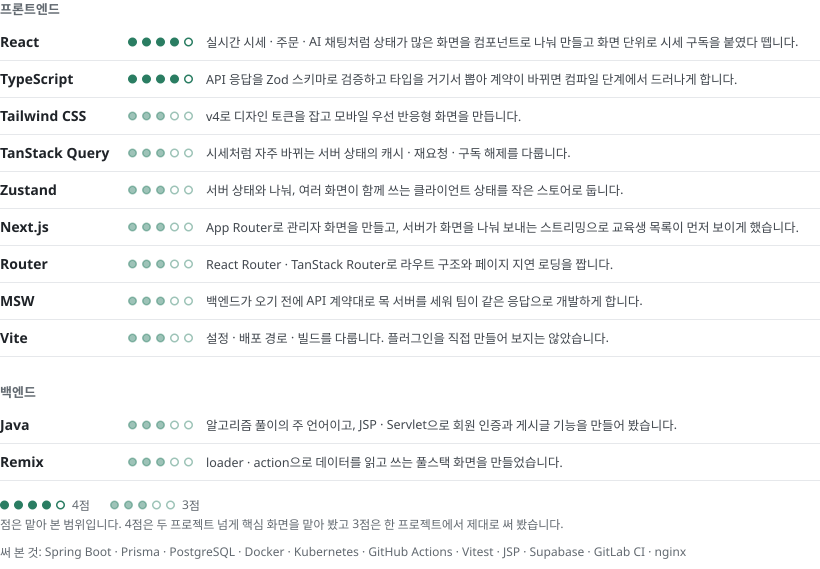

<picture>
  <source media="(prefers-color-scheme: dark)" srcset="./assets/hero-dark.svg">
  
</picture>

기업 연계 프로젝트 글로케어에서 직원용 관리자 화면(어드민)과 dev 서버 · CI를 맡았습니다. 
무엇을 만들지 정하고 에이전트가 낸 안을 검토 · 승인한 뒤 측정으로 확인했습니다.

<a href="https://trossyou.github.io/portfolio/"><picture><source media="(prefers-color-scheme: dark)" srcset="https://img.shields.io/badge/Portfolio-4C6CB3?style=for-the-badge"></picture></a>
&nbsp;<a href="mailto:seungju.you1@gmail.com"><code>seungju.you1@gmail.com</code></a>

## 대표 프로젝트

<table>
<tr>
<td width="44%" valign="top"> 어드민 교육생 상세 · 더미 데이터로 찍은 화면</td>
<td valign="top">
<b>글로케어</b> 2026.10–11 · 6인 · SSAFY 기업 연계 · 런칭 예정 
외국인 요양보호사의 교육부터 취업까지 한 곳에서 돕는 서비스  
직원이 수동으로 기입하던 관리자 화면을 결제 · 배정 기록과 연결된 어드민으로 다시 만드는 일을 팀원 한 명과 맡았고 팀의 dev 서버와 CI도 담당했습니다.  
학습이 멈춘 교육생 찾기 <b>74 → 2클릭</b>  
<a href="https://glocare.co.kr"><picture><source media="(prefers-color-scheme: dark)" srcset="https://img.shields.io/badge/Live-4C6CB3?style=for-the-badge"></picture></a> <a href="https://k15a401.p.ssafy.io/"><picture><source media="(prefers-color-scheme: dark)" srcset="https://img.shields.io/badge/Demo-4C6CB3?style=for-the-badge"></picture></a> <a href="https://github.com/TrossYou/portfolio/blob/main/case-studies/glocare.md"><picture><source media="(prefers-color-scheme: dark)" srcset="https://img.shields.io/badge/Case_Study-4C6CB3?style=for-the-badge"></picture></a> 
Live는 런칭 예정 주소로, 지금은 리뉴얼 전 화면입니다. Demo는 팀이 만든 교육생 웹의 리뉴얼 시연입니다.
</td>
</tr>
<tr>
<td width="44%" valign="top"></td>
<td valign="top">
<b>FINCH</b> 2026.08–09 · 5인 · SSAFY 특화 
내 계좌와 성향을 읽고 투자 판단을 돕는 AI 비서가 있는 증권 앱  
프론트엔드 구현 전반을 맡아 종목 상세 · 주문 · AI 채팅 화면과 API 계약 문서 · 목 서버를 만들었습니다.  
파트 간 문의 이슈 <b>105건</b> (팀 5인 전원 작성, 5주)  
<a href="https://finchapp.org"><picture><source media="(prefers-color-scheme: dark)" srcset="https://img.shields.io/badge/Live-4C6CB3?style=for-the-badge"></picture></a> <a href="https://youtu.be/4Cbu0-vMve4"><picture><source media="(prefers-color-scheme: dark)" srcset="https://img.shields.io/badge/Demo-4C6CB3?style=for-the-badge&logo=youtube&logoColor=white"></picture></a> <a href="https://github.com/TrossYou/portfolio/blob/main/case-studies/finch.md"><picture><source media="(prefers-color-scheme: dark)" srcset="https://img.shields.io/badge/Case_Study-4C6CB3?style=for-the-badge"></picture></a> <a href="https://github.com/Team-FINCH/finch-frontend"><picture><source media="(prefers-color-scheme: dark)" srcset="https://img.shields.io/badge/Repo-4C6CB3?style=for-the-badge&logo=github&logoColor=white"></picture></a>
</td>
</tr>
<tr>
<td width="44%" valign="top"></td>
<td valign="top">
<b>PinLog</b> 2026.07–08 · 6인 · SSAFY 공통 
장소 이름이 기억나지 않아도 경험과 감정으로 다시 찾는 AI 장소 기록 서비스  
지도 기반 기록 · 자연어 검색 결과 · 컬렉션 피드 화면을 맡았고, 검색 결과가 뜰 때 서체가 바뀌던 깜빡임은 미리 받는 안을 제안하고 측정으로 확인했습니다.  
검색 결과가 뜨기 약 <b>806ms</b> 전에 손글씨 서체 준비 (전에는 결과보다 약 11ms 늦음)  
<a href="https://youtu.be/lD5MbHL9TZ8"><picture><source media="(prefers-color-scheme: dark)" srcset="https://img.shields.io/badge/Demo-4C6CB3?style=for-the-badge&logo=youtube&logoColor=white"></picture></a> <a href="https://github.com/TrossYou/portfolio/blob/main/case-studies/pinlog.md"><picture><source media="(prefers-color-scheme: dark)" srcset="https://img.shields.io/badge/Case_Study-4C6CB3?style=for-the-badge"></picture></a> <a href="https://github.com/Team-PinLog/front"><picture><source media="(prefers-color-scheme: dark)" srcset="https://img.shields.io/badge/Repo-4C6CB3?style=for-the-badge&logo=github&logoColor=white"></picture></a>
</td>
</tr>
</table>

## AI 에이전트로 일하는 방식

글로케어 6주 동안 Claude Code 세션을 역할별로 나눠 돌렸습니다. 배분 · 감시 · 리뷰 세션을 하나씩 두고 기능 세션은 최대 다섯 개까지 티켓 하나씩 맡겼습니다. 
에이전트는 구현부터 MR · 리뷰 답글까지 하고, MR 생성 · 머지 · 삭제 · 배포 · 의존성 추가처럼 되돌리기 어려운 일은 훅이 멈춰 세우고 직접 허가합니다. 
AI가 쓴 코드는 그 코드를 쓰지 않은 에이전트가 MR 전에 체크리스트로 검사하고 main 앞에서 CI가 한 번 더 확인합니다.

**작업 규모** · 내가 올려 머지된 MR 285건 (팀 전체 1,246건) · 리뷰어로 들어간 머지 MR 193건 · 완료한 Jira 티켓 201건 · 리뷰 기록 문서 129건

GitHub 잔디가 10~11월에 비어 있는 이유는 글로케어를 SSAFY GitLab · Jira에서 진행했기 때문입니다.

<a href="https://github.com/TrossYou/portfolio/blob/main/case-studies/harness.md"><picture><source media="(prefers-color-scheme: dark)" srcset="https://img.shields.io/badge/Case_Study-4C6CB3?style=for-the-badge"></picture></a>

## 할 수 있는 것

<picture>
  <source media="(prefers-color-scheme: dark)" srcset="./assets/skills-dark.svg">
  
</picture>

## AI 에이전트 도입 전 프로젝트

- [formabridge](https://github.com/TrossYou/portfolio/blob/main/case-studies/formabridge.md) 2025.03–11 · 음악 기록 SNS. K-PaaS 공모전, 4인. Remix 풀스택과 Spotify ID 백필 배치
- [Sorizip](https://github.com/dongcheolpark/sorizip) 2025.11 · 중고 악기 거래 플랫폼. 수업 3인 팀에서 JSP · Servlet 회원 인증과 게시글
- [algorithm](https://trossyou.github.io/algorithm/) 2022– · 프로그래머스 · 백준 · SWEA 풀이(Java)와 학습 로그 대시보드(Vanilla JS)
- [mood-music-recommender](https://github.com/TrossYou/mood-music-recommender) 2025.06 · 이미지의 인물 · 배경 분위기를 CLIP으로 따로 읽어 음악을 추천. 컴퓨터비전 수업 개인 프로젝트
- [xv6 MLFQ 스케줄러](https://github.com/TrossYou/xv6-mlfq-scheduler) 2024 · 교육용 운영체제 xv6 커널에 4단계 MLFQ 스케줄러와 Aging을 C로 구현
- [Yacht Dice](https://github.com/dongcheolpark/Yacht_Dice_C) 2021.12–2022.02 · 처음 코딩을 배우던 때의 팀 프로젝트. C++ 터미널 주사위 게임, TCP 소켓 대전
