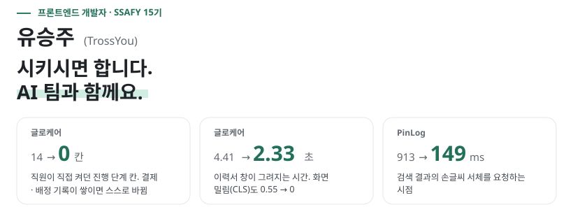

<picture>
  <source media="(prefers-color-scheme: dark)" srcset="./assets/hero-dark.svg">
  
</picture>

직접 코딩하던 때부터 AI 세션 여럿을 나눠 돌리는 지금까지, 
AI가 하는 몫은 커졌고 무엇을 할지 정하고 결과를 확인하는 일은 늘 제가 했습니다.

&nbsp;<a href="mailto:seungju.you1@gmail.com"><code>seungju.you1@gmail.com</code></a>

## 해온 일

<table>
<tr>
<td width="44%" valign="top"> 관리자 화면 교육생 상세 · 더미 데이터로 찍은 화면</td>
<td valign="top">
<b>글로케어</b> 2026.10–11 · 6인(관리자 화면 3) · SSAFY 기업 연계 · 런칭 준비 중 · AI 팀 운영 
외국인 요양보호사의 교육부터 취업까지 돕는 서비스  
교육생이 학습하는 웹과 직원이 교육생을 챙기는 관리자 화면을 6명이 6주 동안 만들었습니다. 저는 디자인 시안 · 관리자 화면(교육생 · 직원 권한 · 문자 발송) · 개발 서버와 CI · 서비스 소개 영상을 맡았습니다.  
직원이 직접 켜던 진행 단계 칸 <b>14 → 0</b> · 이력서 창이 그려지는 시간 <b>4.41 → 2.33초</b>  
  
서비스는 런칭을 준비하고 있어 아직 공개 주소가 없습니다. Demo는 팀이 만든 교육생 웹의 리뉴얼 시연입니다.
</td>
</tr>
<tr>
<td width="44%" valign="top"></td>
<td valign="top">
<b>FINCH</b> 2026.08–09 · 5인 · SSAFY 팀 프로젝트 · 역할을 나눔 
내 계좌와 성향을 읽고 투자 판단을 돕는 AI 비서가 있는 증권 앱  
프론트엔드 구현 전반을 맡아 종목 상세 · 주문 · AI 채팅 화면과 API 계약 문서 · 목 서버를 만들었습니다.  
프론트엔드 커밋 <b>692개 중 510개</b> · 파트 간 문의 이슈 <b>105건</b>(팀 5인 전원 작성, 5주)  
   
</td>
</tr>
<tr>
<td width="44%" valign="top"></td>
<td valign="top">
<b>PinLog</b> 2026.07–08 · 6인 · SSAFY 팀 프로젝트 · AI와 한 작업씩 
장소 이름이 기억나지 않아도 경험과 감정으로 다시 찾는 AI 장소 기록 서비스  
지도 기반 기록 · 자연어 검색 결과 · 컬렉션 피드 화면을 맡았고, 검색 결과가 뜰 때 손글씨 서체가 바뀌던 깜빡임은 미리 받는 안을 제안하고 측정으로 확인했습니다.  
서체 요청 시점 <b>913 → 149ms</b>  
  
</td>
</tr>
</table>

## 일하는 방식

프로젝트마다 AI와 일을 나누는 폭을 한 단계씩 넓혔습니다.

| 때 | 단계 | 한 일 |
|---|---|---|
| ~ 2025 | 직접 코딩 | 음악 SNS, 중고 악기 거래, 운영체제 스케줄러까지 손으로 짰습니다 |
| 2026.07 · PinLog | AI와 한 작업씩 | 규칙 문서를 두고 하나씩 지시하다가, 커밋 전에 보고받고 승인하는 절차를 거쳐 여럿을 동시에 돌렸습니다 |
| 2026.08 · FINCH | 역할을 나눔 | 작업을 지시하고 검토하는 대화와, 모르는 개념을 공부하는 대화를 따로 뒀습니다 |
| 2026.10 · 글로케어 | AI 팀을 운영 | 배분 · 감시 · 리뷰 세션과 기능 세션 최대 5개. 합치기 · 지우기 · 배포는 제가 허가해야 진행됩니다 |

AI가 쓴 코드는 그냥 믿지 않고 네 번 거릅니다.

1. 올리기 전에 체크리스트로 검사합니다. 실패했을 때의 처리와 범위 밖 값까지 봅니다.
2. 기능과 테스트 파일을 같은 MR에 올리고, 자동 검사(CI)를 통과해야 합칩니다.
3. 같이 관리자 화면을 만든 팀원이 스레드로 단 리뷰를 하나씩 고쳐 해결합니다.
4. 팀원 코드도 같은 기준으로 리뷰합니다. 문제 되는 줄을 발췌하고, 실행해서 확인한 것과 코드만 읽고 판단한 것을 나눠 적습니다.

**작업 규모(글로케어)** · 머지된 MR 285건(팀 전체 1,246건) · 리뷰어로 들어간 머지 MR 193건 · 완료한 작업 티켓 201건

GitHub 잔디가 10~11월에 비어 있는 이유는 글로케어를 SSAFY GitLab · Jira에서 진행했기 때문입니다.

## 할 수 있는 것

<picture>
  <source media="(prefers-color-scheme: dark)" srcset="./assets/skills-dark.svg">
  
</picture>

**교육 · 자격** · SSAFY 15기(2026.01–12) · 숭실대학교 컴퓨터학부 졸업 · 정보처리기사 · SQLD · TOPCIT 수준 3 · TOEIC Speaking IH

## AI를 쓰기 전 직접 짠 코드

- [formabridge](https://github.com/TrossYou/portfolio/blob/main/case-studies/formabridge.md) 2025.03–11 · 음악 기록 SNS. K-PaaS 공모전, 4인. Remix 풀스택과 Spotify ID 백필 배치
- [Sorizip](https://github.com/dongcheolpark/sorizip) 2025.11 · 중고 악기 거래 플랫폼. 수업 3인 팀에서 JSP · Servlet 회원 인증과 게시글
- [algorithm](https://trossyou.github.io/algorithm/) 2022– · 프로그래머스 · 백준 · SWEA 풀이(Java)와 학습 로그 대시보드(Vanilla JS)
- [mood-music-recommender](https://github.com/TrossYou/mood-music-recommender) 2025.06 · 이미지의 인물 · 배경 분위기를 CLIP으로 따로 읽어 음악을 추천. 컴퓨터비전 수업 개인 프로젝트
- [xv6 MLFQ 스케줄러](https://github.com/TrossYou/xv6-mlfq-scheduler) 2024 · 교육용 운영체제 xv6 커널에 4단계 MLFQ 스케줄러와 Aging을 C로 구현
- [Yacht Dice](https://github.com/dongcheolpark/Yacht_Dice_C) 2021.12–2022.02 · 처음 코딩을 배우던 때의 팀 프로젝트. C++ 터미널 주사위 게임, TCP 소켓 대전
